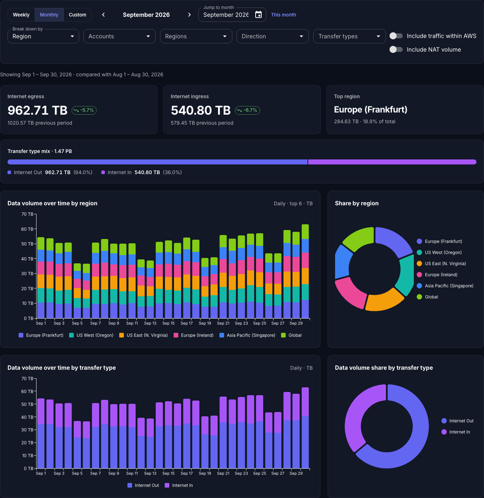

# DTO Explorer

A web app that totals **AWS data transfer volume** (GB) for a week, a month or a custom date range. By default it shows traffic to and from the internet: egress leaving AWS and ingress arriving in AWS. A switch adds traffic that stays on AWS's network (inter-AZ, inter-region and to CloudFront). It breaks the volume down by region, account, direction, transfer type, service, usage type, cost allocation tag (for example a VPC tag) or cost category. It reports volume only, not cost.

- **Backend:** Python, FastAPI and boto3, with AWS Cost Explorer as the data source
- **Frontend:** React 19, Vite, MUI v7 and MUI X (Charts, DataGrid, Date Pickers), with light and dark mode
- **License:** MIT (see [LICENSE](LICENSE))
- **Packaging:** one Docker image (FastAPI serves both the API and the built UI), published to GHCR when a release is tagged



## Contents
- [Features](#features)
- [Requirements](#requirements)
- [Using it](#using-it)
- [AWS setup](#aws-setup)
- [Configuration](#configuration)
- [Development](#development)
- [Releasing](#releasing)
- [How traffic is classified](#how-traffic-is-classified)
- [API](#api)

## Features
- **Periods:** weekly (Monday–Sunday) or monthly with previous/next navigation, or a custom range with presets (last 7/30/90 days, year to date, last 12 months)
- **Headline numbers:** internet egress and ingress volume (plus transit inside AWS when shown), each with the change against the previous period of the same length, plus the top contributor
- **Charts and table:** stacked daily or monthly volume charts by breakdown and by transfer type, share donuts, and a sortable, searchable table with click-to-drill-down
- **Filters:** account, region, direction and transfer type, plus drill-down filters on any dimension
- **Other:** CSV export, shareable URLs, [Include traffic within AWS](#internet-traffic-by-default) and [Include NAT volume](#avoiding-double-counting) switches, and a mock-data mode that needs no AWS account

## Requirements

| To… | You need |
|---|---|
| Run with Docker | Docker, plus AWS credentials in `~/.aws` |
| Run from source | Python ≥ 3.11 with [uv](https://docs.astral.sh/uv/), Node ≥ 20 with npm, and `make` |
| Read real data | Cost Explorer enabled in the AWS account, and the [IAM permissions](#iam-permissions) below |

## Using it

### Option A: Docker image (recommended)

```bash
aws sso login --profile my-profile          # or any other way of getting credentials

docker run --rm -p 8000:8000 \
  -v ~/.aws:/home/app/.aws \
  -e AWS_PROFILE=my-profile \
  ghcr.io/<owner>/<repo>:latest
```
Then open http://localhost:8000.

- The `~/.aws` mount gives the container your config and SSO token cache. It's mounted read-write so that boto3 can refresh SSO tokens.
- Static credentials work too: pass `-e AWS_ACCESS_KEY_ID -e AWS_SECRET_ACCESS_KEY -e AWS_SESSION_TOKEN` instead of the mount.
- To try it without AWS: `docker run --rm -p 8000:8000 -e DTO_MOCK=1 ghcr.io/<owner>/<repo>:latest`
- To build the image locally: `make docker && make docker-run AWS_PROFILE=my-profile`

### Option B: From source

```bash
git clone https://github.com/<owner>/<repo>.git && cd <repo>
make install                             # uv sync + npm install

make dev-mock                            # synthetic data → http://localhost:5173
AWS_PROFILE=my-profile make dev          # real data      → http://localhost:5173
AWS_PROFILE=my-profile make serve        # production build, one process → http://localhost:8000
```

`make dev` runs uvicorn with auto-reload on `:8000` and Vite on `:5173`. Vite forwards `/api` requests to uvicorn.

### Option C: Terminal UI

[DTO TUI](https://github.com/zscclabs/dto) is a separate project with the same capabilities in the terminal: a single Python script you run with `uv run dto_tui.py`.

### Single account vs. AWS Organization
- **Single account:** use that account's credentials. The account filter will show just that one account.
- **Organization:** use credentials for the **management (payer) account** to see every linked account. Breaking down by account then shows each account by name.

### When your SSO session expires
The UI shows an AWS error. Run `aws sso login --profile my-profile` again. You don't need to restart, but if errors persist, restart the app.

## AWS setup

### IAM permissions
```json
{
  "Version": "2012-10-17",
  "Statement": [{
    "Effect": "Allow",
    "Action": ["ce:GetCostAndUsage", "ce:GetDimensionValues", "ce:GetTags", "ce:GetCostCategories"],
    "Resource": "*"
  }]
}
```

### Cost Explorer API charges
Each Cost Explorer request costs **$0.01**. One dashboard view makes about 12 requests on a cold cache. Responses are cached in memory for 1 hour (`DTO_CACHE_TTL_SECONDS`). The ↻ button in the UI clears the cache and fetches fresh data.

### Per-VPC breakdown
Cost Explorer has **no VPC dimension**. To get a per-VPC breakdown:
1. Tag resources that generate data transfer (NAT gateways, load balancers, EC2 instances, etc.) with something like `vpc=<name>`. An existing `Name` tag works if your resources are named after their VPC.
2. Activate that tag as a **cost allocation tag** in Billing → Cost allocation tags. In an Organization, only the management account can do this. Data appears from the activation date onward.
3. Choose **Tag: vpc** under "Break down by", or set `DTO_DEFAULT_TAG_KEY=vpc` to make it the default.

## Configuration

Set these as environment variables or in `backend/.env`, which git ignores.

| Variable | Default | Purpose |
|---|---|---|
| `AWS_PROFILE` | – | Standard boto3 profile selection |
| `DTO_AWS_PROFILE` | – | Profile used by the app, overriding `AWS_PROFILE` |
| `DTO_MOCK` | `false` | Serve synthetic data instead of calling AWS |
| `DTO_CACHE_TTL_SECONDS` | `3600` | Cache lifetime; `0` disables caching |
| `DTO_DEFAULT_TAG_KEY` | – | Tag key to group by initially (e.g. `vpc`) |
| `DTO_CE_REGION` | `us-east-1` | Cost Explorer endpoint region |

## Development

```
backend/
  app/
    main.py          FastAPI routes; serves frontend/dist when it exists
    dto_service.py   finds data transfer usage types, classifies them, builds Cost Explorer queries, aggregates GB
    ce_client.py     boto3 Cost Explorer wrapper (pagination)
    periods.py       week / month / custom → date windows
    mock_ce.py       synthetic Cost Explorer client for DTO_MOCK=1
  tests/             pytest (botocore Stubber + mock client)
frontend/src/
  App.tsx            page layout, URL-synced state, drill-down
  components/        PeriodSelector, FilterBar, KpiCards, charts, BreakdownTable
scripts/             version bump / check helpers
.github/workflows/   ci.yml, release.yml
```

```bash
make test        # backend pytest + frontend type-check
make build       # production UI bundle → frontend/dist
```

CI (`.github/workflows/ci.yml`) runs the backend tests, the frontend type-check and build, and a Docker build on every push to `main` and on every pull request.

## Releasing

Releases are driven by git tags. The version lives in `backend/pyproject.toml` and `frontend/package.json`, which must match the tag.

1. **Bump the version** (this also refreshes `uv.lock` and `package-lock.json`):
   ```bash
   make bump VERSION=0.2.0
   ```
2. **Update `CHANGELOG.md`:** move the items under `[Unreleased]` into a new `## [0.2.0] - YYYY-MM-DD` section.
3. **Commit, tag and push:**
   ```bash
   git commit -am "Release v0.2.0"
   git tag v0.2.0
   git push origin main v0.2.0
   ```
4. **GitHub Actions** (`.github/workflows/release.yml`) then:
   - checks that the tag matches both version files
   - runs the full CI
   - builds a multi-architecture image (`linux/amd64` and `linux/arm64`) and pushes it to `ghcr.io/<owner>/<repo>` tagged `0.2.0`, `0.2` and `latest`
   - creates a GitHub Release whose notes come from the CHANGELOG section plus auto-generated notes

Tags with a suffix, such as `v0.3.0-rc.1`, are published as pre-releases and don't move `latest`.

**First release only:** after the image is pushed, open the package's settings on GitHub (your profile or org → Packages) and set its visibility. If the repository is private, the package is private too.

## How traffic is classified

The app finds usage types with `GetDimensionValues`, sorts them into transfer types and directions, and adds up their `UsageQuantity` (GB). It never requests cost metrics. It counts only `RECORD_TYPE = Usage` rows: credits and discounts carry no volume and would only add empty groups.

| Direction | Transfer type | Usage type pattern |
|---|---|---|
| Out | Internet Out | `*DataTransfer-Out-Bytes` (includes CloudFront edge egress) |
| Out | Inter-Region Out | `<SRC>-<DST>-AWS-Out-Bytes` |
| Out | Other Out | anything else containing `Out-Bytes`, `Out-OBytes` or `Out-ABytes` |
| In | Internet In | `*DataTransfer-In-Bytes` |
| In | Inter-Region In | `<SRC>-<DST>-AWS-In-Bytes` |
| In | Other In | anything else containing `In-Bytes`, `In-OBytes` or `In-ABytes` |
| Transit | Inter-AZ | `*DataTransfer-Regional-Bytes` |
| Transit | NAT Gateway | `*NatGateway-Bytes` (data processed) |
| Transit | To CloudFront | `*CloudFront-Out-Bytes` |

AWS doesn't charge for inbound transfer from the internet or for the receiving side of inter-region transfer, but it still reports the volume, so the app counts it. Filter or break down by **Direction** to separate Out, In and Transit.

### Internet traffic by default
By default the app counts only traffic to and from the internet: Internet Out and In, and Other Out and In. Inter-AZ, Inter-Region Out, Inter-Region In and To CloudFront stay on AWS's network, so they are hidden. They are left out of the Cost Explorer query, every total and the Transfer types filter. Turn on **Include traffic within AWS** (`include_aws_internal=true`) to add them back. NAT Gateway keeps its own switch.

### Avoiding double-counting
The same bytes can be reported under more than one usage type. Take 100 GB that goes from an instance through a NAT gateway in another AZ out to the internet. AWS reports it as:

- Inter-AZ: 200 GB, because Inter-AZ is counted on both the sending and the receiving side
- NAT Gateway data processed: 100 GB
- Internet Out: 100 GB

That adds up to about 400 GB of usage for 100 GB that actually left AWS. The app handles this as follows:

- **Egress** and **Ingress** count each byte once, at the point where it leaves or enters AWS or crosses regions.
- **Transit** types move data inside AWS. Their bytes show up again under an Out or In type, or, for Inter-AZ, twice. The UI shows them as a separate total and labels them "(transit)" in the volume charts.
- **NAT Gateway** volume is left out by default because it duplicates the traffic it carries, in both directions. Turn on **Include NAT volume** (`include_nat_volume=true`) to add it to Transit.

## API

Interactive docs are at `/docs` while the app is running.

- `GET /api/health`: status and version
- `GET /api/meta`: accounts, regions, tag keys, cost categories and breakdown options
- `GET /api/dto/summary?period=week|month|custom&start=YYYY-MM-DD&end=YYYY-MM-DD&group_by=REGION&include_aws_internal=false&include_nat_volume=false&filter=REGION=us-east-1&filter=TAG:vpc=prod`
  - `week` and `month` take the period containing `start` (today by default). `custom` uses `start` to `end`, both inclusive.
  - `group_by`: `REGION`, `LINKED_ACCOUNT`, `SERVICE`, `DIRECTION`, `TRANSFER_TYPE`, `USAGE_TYPE`, `TAG:<key>` or `COST_CATEGORY:<name>`
  - `include_aws_internal`: `false` (default) counts internet traffic only, `true` adds Inter-AZ, Inter-Region Out/In and To CloudFront
  - `include_nat_volume`: `false` (default) leaves NAT Gateway data processed out of every total, `true` adds it to transit
  - All figures are GB. `DIRECTION` (`Out`, `In`, `Transit`) works as a breakdown and as a filter.
  - `filter` can be repeated. Values for the same dimension are OR'd and different dimensions are AND'd. An empty tag value (`TAG:vpc=`) means untagged.
- `GET /api/dto/export.csv`: same parameters, returns a CSV file with GB per row and per transfer type
- `POST /api/cache/clear`
